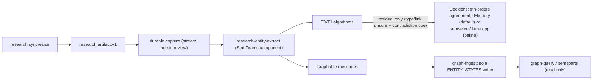
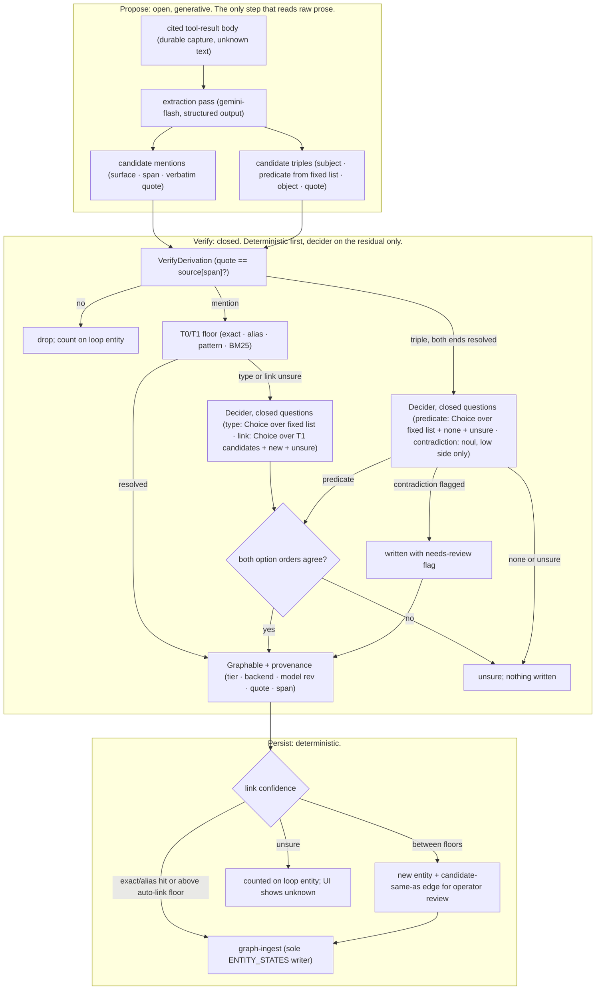

# Entity extraction from research results: planning brief (v8)

**Status:** planning draft with Phase 0 corpus frozen, Phase 2/3 gate baseline measured in pure Go (`docs/proposals/entity-extraction/`), and v2 propose-then-verify architecture incorporated. No runtime component code exists yet. Code references were checked at the SemStreams pin `8b99efe9`, SemTeams `512b4bf2`, SemEngine `7c4dd2c`, semvocab `c8a07be`, semsparql `e7f827c`, semselect `152feca`, SemSource `4093d3c`, and ateam `49aaa08`. Both smoke runs (§7.4) and the 36-case banded gate evaluation (§7.5) ran on 2026-10-21 against `mercury-decide` and `semselect` (`Kev-4B-Q4_K_M` on Metal) and are verified offline in CI by `go test ./docs/proposals/entity-extraction/...`.

## Owner decisions (2026-10-21)

1. **Narrow first use case:** research results.
2. **Types:** a fixed list. SemEngine supplies a tight core vocabulary; semvocab extends it where needed (requiring it is acceptable). semsparql is an indirect consumer.
3. **Persistence:** extracted entities go into the graph through component(s) that emit to the engine. SemEngine (graph-ingest) is the only graph writer.
4. **Runtime:** services stay in Docker Compose, and the golden corpus stays laptop-sized.
5. **Home:** this is a product-side feature in SemTeams, because not every product needs an unstructured-text extractor.
6. **Timing:** it ships after SemTeams moves to SemEngine. It isn't time-critical, but an early adopter is already asking.
7. **GPU:** a host-native model runtime is acceptable, since Docker on a Mac is poor at GPU work.
8. **Model access** goes through a typed, Jev-compatible decider API with swappable backends, tested for the fewest tokens and dollars.
9. **Inception** is already in use: ateam runs Mercury 3 through `INCEPTION_API_KEY` under a budget policy (`internal/bench/mercury.go:27`).
10. **Default backend:** Mercury Decide (hosted). The offline option is a host-native runtime.
11. **Offline runtime:** llama.cpp through **semselect on Metal** (the recommendation was accepted, and both smoke and corpus gate runs passed, §7.4–§7.5).
12. **Mercury smoke budget:** approved, **under $5 in total** for now (total spend across all smoke + corpus runs: **$0.0018**, 45,272 input tokens).
13. **Algorithm versus model benchmarking is a first-class gate.** SemSource showed that results without LLM calls are fine for most of its use case. The model tier has to earn its place, band by band (§7.1, §7.5).
14. **Mercury key for smoke and eval runs:** read at run time from ateam's `.env` (`INCEPTION_API_KEY` only), never copied or printed. SemTeams gets its own key before product use.

## 1. Why research results first

Today none of what a research run finds becomes graph state:

- The `research.artifact.v1` payload is published on `research.artifact.<loop_id>` (`cmd/semteams/tools/emitartifact/executor.go:388-408`). The only streams in `configs/flow-bootstrap.json` are `USER`, `AGENT`, and `TOOL`; I found nothing that retains this subject, which still needs confirming.
- The readable body is a local file, `.artifacts/research/<slug>.md` (`executor.go:111`).
- The graph gets only counts (`executor.go:82-89`). Actor content is deliberately kept out of the marker triples (`executor.go:31`).

Each actor and integration point already carries a verbatim quote that `VerifyDerivation` (`derivation.go:172`) has checked against a real tool result. So **v1 is typing, linking, and contradiction checking over a small, verified input**.

**v1 scope:** actors, integration points, and the quotes and tool-result records they cite.
**Not in v1:** free extraction over whole pages (v2 / Phase 2a–2b, §4.1), and user-supplied documents.

## 2. Write path



The design must follow these rules:

- **Only graph-ingest writes `ENTITY_STATES`;** other code emits `graph.Graphable` (SemEngine `AGENTS.md` §2, `graph-entity-writes` spec, ADR-110).
- **Stable identity:** each entity has a 6-part ID derived from its type and normalized name, so re-runs append rather than duplicate. This needs checking against SemEngine ADR-102.
- **Provenance:** statement metadata records the loop ID, `tool_result_ref`, locator, quote, span, **the tier that decided (T0, T1, or the decider), and the backend and model revision** when a model decided.
- **Unsure is not none:** an `unsure` decision (including forward/reverse option-order disagreement) or a decider error writes no entity. It is counted on the loop entity, so the UI can show `unknown`.
- **Merge safety:** link only on an exact alias hit or a confident decision where both option orders agree. Otherwise create a new entity plus a candidate same-as link for review.

## 3. Vocabulary: a fixed list

Internal names are dotted; IRIs appear only at the export edge (SemEngine ADR-107).

| Type | CCO class | In the semvocab catalog today? |
| --- | --- | --- |
| person | `cco.Person` | yes (`catalog/cco/cco.go:51`) |
| organization | `cco.Organization` | yes (`:53`) |
| software | CCO Software | **no, needs an extension** |
| repository | to be decided | **no, needs an extension** |
| specification | CCO ICE subclass | **no; only the generic ICE is admitted** |
| event | `cco.Act` | yes (`:57`) |
| concept | none (unmapped) | not applicable |

Relationship predicates come from `integration_points` and follow the 3-segment lower-kebab contract. The pack is written as SHACL shapes and compiled with semvocab `shacl.Compile`.

## 4. Extraction tiers (v1) and Propose-then-Verify (v2)

- **T0, deterministic:** Unicode NFKD + diacritic folding (`foldText` in `algo.go`); exact lookup in `ALIAS_INDEX` and the configured portfolio (`configs/portfolio-c360.json`); deterministic ID patterns (`owner/repo`, `RFC NNNN`, `ADR-NNN`, `CVE-YYYY-NNNN`). Check mechanically whether the actor's name or a known alias appears in the quote. If the actor is not mentioned in the quote, suppress immediately (resolves Band B4 with zero model calls).
- **T1, statistical:** BM25 IDF-weighted token overlap over catalog names, aliases, and descriptions (requiring at least one name/alias token hit, top-1 score `>= 0.70`, and top-1 over top-2 margin `>= 0.25`). If zero catalog candidates match a non-pattern name, T0/T1 sets `link = "new"` and leaves `type = "unsure"`.
- **T2, decider (with both-orders agreement on the residual):** called only when T0/T1 leaves `type` or `link` as `unsure` or when `hasContradictionCue` fires on the quote. Queries both `forward` and `reverse` option orders and requires agreement (`forward == reverse`, else `unsure`).

### 4.1 Phase 2 (v2): Free extraction over cited tool-result bodies as Propose-then-Verify

A decision model answers closed questions well (which type, which catalog entry, which fixed predicate, does the text contradict this claim) and cannot discover open-ended entities or triples in unknown prose. In v1, the researcher persona already proposed actors, roles, and quotes in `research.artifact.v1`. Phase 2 reads raw tool-result bodies, so it places an explicit generative proposer in front of the same closed verify chain. Mercury `extract` is optional span-boundary support only, never the proposer (and the offline `semselect` backend has no `extract` at all).



- **Three jobs, three tools:** Propose (`gemini-flash` structured output) is the only open-ended step and the only one that sees raw prose. Verify (`VerifyDerivation` → T0/T1 → Decider with both-orders agreement) asks closed questions only. Persist (`graph-ingest`) is deterministic.
- **Triples are the v2 surface:** The proposer emits `(subject, predicate from fixed list, object, verbatim quote)`. Both ends must resolve as mentions before the `predicate` Choice question is asked. Phase 2a adds a 6-case `B7 predicate` band to `corpus_v1.json` and gates the `gemini-flash` proposer against a lexical candidate generator (capitalized spans, ID patterns, catalog hits).
- **One-sided contradiction flag (`A2`):** `noul` is evaluated only on the low side (`p_yes <= contradiction_threshold`). A low `noul` score marks the statement `needs-review` and still writes it; nothing is suppressed on researcher role gloss.
- **Budget shape:** One proposer call per tool-result body, then Decider calls equal to residual mentions plus proposed triples, times two for the `forward`/`reverse` agreement check. Proposer unavailable means nothing written and counted `unknown`, with no cross-backend fallback.

## 5. Backend selection

### 5.1 Default: Mercury Decide

- **Endpoint:** `https://api.inceptionlabs.ai/v1/decisions`, model `mercury-decide`, key from `INCEPTION_API_KEY`, declared in the `model` registry (`api_key_env`) under the `entity_decision` capability.
- **Why it is the default:** no GPU, no extra Compose service, about $0.0002–$0.0004 per artifact, and the only backend with optional `extract` span support.
- **Data policy:** actor names, quotes, and context windows go to Inception as a second processor after Gemini. Operator docs name it and give the switch to offline mode.

### 5.2 Offline: llama.cpp through semselect on Metal

- semselect is llama.cpp plus a small Go guard serving native System One at `127.0.0.1:8084` (`task metal:serve`). It has a pinned build and models (Kev-4B, Qwen3.5-4B, Julia-1) and is reached from Compose at `host.docker.internal:8084`.
- **Observed in the smoke and gate runs:** the response shape (`noul`, `choice`/`probabilities`/`confidence`, `score`, `usage.input_tokens`) matches Mercury's documented shape.
- **Caveats (including `A5` link scope):**
  - **On `link`, `semselect` (Kev-4B) contributes only catalog homonym disambiguation (`b3-01..03` at `0.71–0.79` confidence):** on novel entities (`b3-04..06`), raw Kev-4B `link = new` confidence is weak (`0.10–0.62`, with `b3-05` at `0.20–0.23` and `b3-06` at `0.10–0.12`). In the Gated Hybrid arm, novel-entity `link = new` detection is carried entirely by T0/T1's zero-candidate rule while Kev-4B types the novel entity (`0.71–0.96`) and disambiguates competing catalog homonyms.
  - semselect currently describes itself as an evaluation and reference service; product use needs that stance updated in semselect.
  - The guard admits one request at a time (others get 429), which is about 1.1–1.5 actors per second (~880 ms median when asking 3 questions).
  - The guard caps the state at 8 KiB and allows 4 questions per request, and has no `extract`.
- **Why it must run on the host:** in Docker on CPU, Qwen3.5-4B took a median of 49 s per request and Kev 185–196 s (semselect, M3 Pro).

### 5.3 Switching and failure

- **No automatic cross-backend fallback.** Thresholds are set per backend, so switching is an explicit operator choice of the capability's `preferred` endpoint.
- **When the backend is unavailable,** decisions are recorded as `unknown` and nothing is written. Durable capture allows reprocessing later.
- **Budget guard (ateam pattern):** the key stays in Go, token ceilings apply per run and per day, and a run stops if usage is missing.

## 6. Decider: a typed, Jev-compatible API

### 6.1 Why a new interface

None of our current model adapters returns decision probabilities. `agentic-model` `ProviderAdapter` (`adapter.go:15`) handles chat only. `model/wire` leaves `Choice.Logprobs` unparsed (`types.go:78`). `graph/query.LLMClient` (`classifier_llm.go:15`) prompts for JSON labels. The decision-model vendors share the **System One** request shape, in dialects:

| Server | Path | Notable differences |
| --- | --- | --- |
| **Mercury Decide (default)** | `/v1/decisions` | State may be a string, object, array, or images. Choice takes 1–255 options; Score 1–10 levels; requests up to 32,768 tokens. Adds **`extract`** |
| **semselect / llama.cpp (offline)** | `/v1/systemone` | 8 KiB state, 1–4 questions, 2–16 options, one request at a time |
| Jev (TypeSafe) | `/v1/systemone` (reported) | **Unverified** |

The decider adopts the common core and treats the differences as a per-endpoint dialect. Endpoint selection reuses the `model` registry, which is already ported to SemEngine.

### 6.2 Contract (sketch)

```go
type Decider interface {
    Decide(ctx context.Context, req Request) (Response, error)
    Capabilities() Caps // dialect limits; SupportsExtract, MaxOptions, MaxTokens...
}

type Request struct {
    State     string              // evidence only (see 6.4); capped by the dialect
    Questions map[string]Question // 1..4 for the common core
}

type Question struct {
    Type         Kind              // Choice | Score | Noul | Extract
    Instructions string            // carries the claim being judged
    Options      map[string]string // Choice
    Levels       []string          // Score
    Fields       map[string]string // Extract
    Threshold    float64           // Extract
}

type Response struct {
    Model    string
    Backend  string
    Answers  map[string]Answer
    Fidelity Fidelity // Native | Logprob | LabelOnly
    Usage    Usage
}

type Answer struct {
    Choice        string
    Probabilities map[string]float64 // nil when LabelOnly
    Confidence    *float64           // nil means unknown; never invented
    Score         *float64
    PYes          *float64
    Spans         map[string][]Span  // Extract: verbatim spans
    NotStated     map[string]float64
}

type Span struct {
    Text       string
    Start, End int     // byte offsets into State, after conversion
    Confidence float64
}
```

A backend without `extract` returns `ErrUnsupported`. Errors are classified: busy or 429 means bounded retry; invalid means refuse; unavailable means fail closed to `unknown`.

**Offset hazard (confirmed by the smoke run and enforced by `TestPhase0CorpusAndFixturesIntegrity` in `eval_gate_test.go`):** Mercury's offsets are **Unicode code points**. In the emoji case (`fixtures/mercury/quote/c5-unicode.json`), the span after the emoji matched code-point slicing (`[]rune(state)[start:end]`) but **not** UTF-16 (JavaScript) or UTF-8 byte slicing, so the docs' claim that JavaScript `slice` also matches is wrong outside the Basic Multilingual Plane. The adapter converts code points to Go byte offsets and **accepts a span only if `State[Start:End] == Text`**.

### 6.3 Backends

| Backend | Talks to | Fidelity | Role |
| --- | --- | --- | --- |
| `systemone` | Mercury (`/v1/decisions`); semselect/llama.cpp (`/v1/systemone`); Jev | Native | Default and offline |
| `logprob` | Ollama, or any OpenAI-compatible endpoint | Logprob | Evaluation arm only, unless the gate says otherwise |
| `json` | existing `agentic-model` adapters | LabelOnly | Status-quo comparison only |

### 6.4 Questions per actor, the evidence-only rule, and both-orders agreement

**Rule, from the smoke run:** `state` holds **only the evidence**: the quote and up to ±300 characters of context. The actor name and the claimed role go in the question's instructions. With the claim inside the state, Kev treated it as evidence and said yes (0.79) to a false claim. With the claim moved into the question, the same case scored 0.004 (§7.4).

One pair of requests (`forward` and `reverse` option order, requiring agreement per `A3`) asks only the questions T0/T1 left unresolved:

- **`type`:** Choice over the fixed list, plus `not_an_entity` and `unsure` (asked only when T0/T1 returned `type = unsure`).
- **`link`:** Choice over the T1 candidates, plus `new` and `unsure` (asked only when T0/T1 returned `link = unsure`, i.e., competing catalog homonyms).
- **`support` (one-sided contradiction flag, `A2`):** Noul: `p_yes <= contradiction_threshold` (`0.01` on Mercury, `0.055` on Kev-4B) flags `needs-review` on explicit contradictions (`b5-01..03`) without ever suppressing entity emission on researcher role gloss.
- **`predicate` (for `integration_points` in v1 and proposed triples in v2):** Choice over the fixed predicate list, plus `none` and `unsure` (the predicate has no free-text gloss).

## 7. Benchmarking and test plan

### 7.1 Algorithm floor first: the gate the model must pass

This follows the SemSource scorecard (`scripts/scorecard/README.md`). Its v5 run (`results/SUMMARY-v5-loose.md`) declared the gate before running it: if the deterministic product surface already passes a band, the dormant T1 classifier stays off. It passed 33/33, so the classifier stayed off. We apply the same discipline here in Go (`docs/proposals/entity-extraction/algo.go`, `eval_gate.go`, `eval_gate_test.go`).

**The algorithm-only arm for each question:**

| Question | Algorithm-only answer |
| --- | --- |
| type | Portfolio or alias hit takes the type of the existing entity; ID patterns (`owner/repo`, `RFC NNNN`, `ADR-NNN`, `CVE-YYYY-NNNN`); otherwise `unsure` |
| link | Unique exact/alias hit links; BM25 IDF top-1 `>= 0.70` with `>= 0.25` margin over top-2 links; zero catalog hits on a non-pattern name returns `new`; competing homonyms return `unsure` |
| mention | **Mention check (`expect.mention`):** the name or a catalog alias appears in the quote (after NFKD/diacritic folding). Rejects unmentioned actors (`False` on B4, `36/36` across B1–B6 when warm) |
| support (contradiction flag, `A2`) | **Lexical negation cue (`hasContradictionCue`):** routes quotes containing negation/contrast cues (`never`, `no `, `not `, `read-only`, `only for`) to Decider `noul`, which flags `needs-review` when `p_yes <= contradiction_threshold` |

**Bands:** the corpus is labeled into 6 bands (6 cases per band = 36 cases across 12 artifacts in `corpus_v1.json`):

| Band | Example |
| --- | --- |
| B1 exact or alias | `C360Studio/semengine`, `SemStreams`, `NATS JetStream`, `ADR-061`, `RFC 9110`, `Synadia` |
| B2 lexical variant | `K8s` vs Kubernetes; `Mosquitto MQTT Broker` vs Eclipse Mosquitto; `c360studio/sem-teams` |
| B3 ambiguous name | `Mercury` (Inception model vs fintech bank); `Vault` (HashiCorp vs Ansible); novel person/event/concept |
| B4 unsupported claim | the quote doesn't mention the actor (`Kubernetes`, `Apache Kafka`, `PostgreSQL`, `Redis Cluster`, etc.) |
| B5 role-only support | the name is mentioned, with 3 explicitly contradicted roles (`semsparql` as writer, etc.), 2 roles with unstated gloss (`SemEngine` "graph ingest", `semvocab` "ontology catalog"), and 1 strictly entailed role (`NATS JetStream`) |
| B6 non-ASCII | accented names (`Gödel-SDK`, `Zürich Instruments`, `Ångström-Bus`), ASCII-folded `Francois Chollet`, NFD `München-Lab/quantum-sim`, emoji |

**Provisional thresholds (`corpus_v1.json.gate_thresholds`, enforced identically across all arms in `eval_gate.go`; provisional at `n=6` per band per `A4`):**
- Band gate thresholds: `coverage_floor = 0.80` (1-case margin at `n=6`), `wrong_confident_ceiling = 0.05`, `false_merge_ceiling = 0.00`.
- Per-decision provisional thresholds: `confidence_threshold_mercury = 0.55`, `confidence_threshold_semselect = 0.55` for `choice` (`type` and `link`); `contradiction_threshold_mercury = 0.01`, `contradiction_threshold_semselect = 0.055` for the one-sided `noul` contradiction flag (`A2`); and `support_threshold_yes = 0.60`, `support_threshold_no = 0.40` when evaluating strict two-sided `role` entailment (`H2/M1/M3`).

**Verdicts, declared before any run:**
- **The algorithm passes the band** (meets `coverage >= 0.80`, `wrong_confident <= 0.05`, and `false_merge == 0.00`): **the model tier stays off for that band.**
- **The algorithm fails and the model passes:** the model is enabled **for that band's unresolved residual only**, and the gain is reported next to the cost and latency.
- **Both fail:** the band stays `unsure`, nothing is written, and the gap is filed.

### 7.2 Layers

| Layer | Runs against | Cost | Purpose |
| --- | --- | --- | --- |
| 1. Contract (`eval_gate_test.go`) | 168 checked-in JSON fixtures in `docs/proposals/entity-extraction/` (24 smoke fixtures in `fixtures/` + 144 corpus responses in `eval_cache/`) | $0, in CI (`task validate`) | Request building, normalization math, fidelity, error classes, dialect limits, emoji Unicode code-point offset conversion (`TestPhase0CorpusAndFixturesIntegrity`), no-fallback behaviour, and paired sensitivity tests (`TestGateSensitivity`) |
| 2. Smoke | semselect on Metal (**done**, §7.4); Mercury (**done**, §7.4) | $0.0002 | Every question type, including `extract`, runs end to end; responses become layer 1 fixtures (`fixtures/{mercury,semselect}/{claim,quote}/`) |
| 3. Quality (`eval_gate_test.go`) | Frozen, banded corpus (`corpus_v1.json`, **done**, §7.5) | $0.0016 (both orders); local $0 | The §7.1 gate across all 5 arms, 3 catalog regimes (`warm`, `portfolio`, `empty`), and option orders (`results/eval_*.json`) |
| 4. Hosted comparison | Jev, if a key is available | about $0.01 | Optional |

### 7.3 Cost and token-saving

**Pricing (Inception's page):** $0.04 per million input tokens ($0.02 during the promotion), output free. Total Mercury spend across all smoke + corpus gate runs (84 requests recorded in `results/mercury_ledger.json`) is **45,272 input tokens = $0.00181** at list price, against the $5 approval.

### 7.4 Smoke results (2026-10-21)

6 hand-written cases across both state modes (`claim` vs `quote` evidence-only, recorded in `fixtures/` and summarized in `results/summary_{mercury,semselect}_{claim,quote}.json`):

| Backend | State contents | Type | Support | Latency per request | Input tokens per request |
| --- | --- | --- | --- | --- | --- |
| Kev-4B, semselect on Metal | actor + role + quote | 6/6 | 5/6: yes (0.79) to the false claim | 650–850 ms | 302–342 |
| Kev-4B, semselect on Metal | evidence only | 6/6 | 6/6: false claim 0.004 | about 640 ms | 260–294 |
| Mercury Decide | evidence only, plus `extract` | 5/6* | 6/6: false claim 0.0036 | 346–774 ms | 399–419 |
| Mercury Decide | actor + role + quote, plus `extract` | 6/6 | 6/6: false claim 0.0053 | 382–467 ms | 429–453 |

\* *In `fixtures/mercury/quote/c4-unsupported.json`, the actor `Kubernetes` is absent from the evidence-only quote (`"SemEngine runs on NATS JetStream and needs no external database."`), so Mercury's `type` choice abstained to `unsure` (`0.619`) while `support` returned `0.0036` (`False`).*

### 7.5 Phase 0 Corpus & Phase 2/3 Per-Band Gate Results (2026-10-21 / 2026-10-22)

Frozen corpus: `corpus_v1.json` (`sha256:9559fa798d19e71a9b225ca8d0413c5b01272d62ef02f024741db0cef5578e1a`), 36 labeled actor claims (6 per band across 12 artifacts) and 23 seed catalog entities, evaluated in Go by `algo.go` (`sha256:737e9962926c29c0d48b216480c38887f2a74f040c8c7c6b23116421fd7278c3`) and `eval_gate.go` (`sha256:647004083a9cb20f70d832e34d19db36903f93c326e39270ecc32158da01bd9a`):

| Band | Arm 1: T0/T1 Algo Floor (warm / portfolio / empty) | Arm 2: Mercury Decide (fwd / rev) | Arm 3: Kev-4B semselect (fwd / rev) | Arm 4: Single-Order Non-Oracle Hybrid (`mercury` fwd/rev · `semselect` fwd/rev) | Arm 5: Both-Orders Agreement Hybrid (`hybrid_agree_mercury` · `hybrid_agree_semselect`) | Gate Verdict |
| --- | --- | --- | --- | --- | --- | --- |
| **B1** exact / alias | **Warm 6/6 · 6/6** · Port 5/6 · Empty 3/6 Type (ID patterns) | Type 6/6, 6/6 · Link 4/6, 6/6 · ContraFlag 6/6 · StrictSupp 6/6 | Type 4/6, 4/6 · Link 2/6, 3/6 · ContraFlag 6/6 · StrictSupp 4/6 | **Type 6/6, 6/6 · Link 6/6, 6/6 · ContraFlag 6/6** (0 calls warm) | **Type 6/6 · Link 6/6 · ContraFlag 6/6** (`0%` wc, 0 calls warm) | **ALGO PASS (`type`/`link`/`mention`) → MODEL OFF (when in catalog/pattern)** |
| **B2** lexical variant | **Warm 6/6 · 6/6** · Port 1/6 · Empty 1/6 Type (`owner/repo`) | Type 6/6, 6/6 · Link 6/6, 6/6 · ContraFlag 6/6 · StrictSupp 4/6 (`0%` wc) | Type 5/6, 3/6 · Link 3/6, 3/6 · ContraFlag 6/6 · StrictSupp 3/6 | **Type 6/6, 6/6 · Link 6/6, 6/6 · ContraFlag 6/6** (0 calls warm) | **Type 6/6 · Link 6/6 · ContraFlag 6/6** (`0%` wc, 0 calls warm) | **ALGO PASS (`type`/`link`/`mention`) → MODEL OFF (when in catalog)** |
| **B3** ambiguous / novel | Type 0/6 · Link 3/6 (`new`) · Mention 6/6 | Type 6/6, 5/6 · Link 6/6, 5/6 · ContraFlag 6/6 · StrictSupp 6/6 | Type 6/6, 6/6 · Link 4/6, 4/6 · ContraFlag 6/6 · StrictSupp 5/6 | **Type 6/6, 5/6 (`mercury`) · 6/6, 6/6 (`semselect`) · Link 6/6, 5/6 (`mercury`) · 6/6, 6/6 (`semselect`)** (6 calls) | **Mercury: Type 5/6 (`0%` wc) · Link 5/6 strict / 6/6 mean (`0%` fm) · Kev: Type 6/6 · Link 6/6 (`0%` wc)** (12 reqs) | **ALGO FAIL / MODEL PASS → MODEL ON (`type`/`link == unsure`, both orders)** |
| **B4** unmentioned claim | **Suppressed 6/6 at T0 mention check** (all 3 catalog regimes!) | Suppressed 6/6, 6/6 (`p_yes <= 0.0097`) | Suppressed 6/6, 6/6 (`p_yes <= 0.0507`) | **6/6 suppressed at T0** (0 model calls across all regimes) | **6/6 suppressed at T0** (0 model calls) | **ALGO PASS → MODEL OFF** |
| **B5** role contradiction | **Warm 6/6 · 6/6** · Port 5/6 · Empty 0/6 Type · ContraCue fires 3/3 | Type 6/6, 6/6 · Link 5/6, 5/6 · **ContraFlag 6/6, 6/6** · StrictSupp 5/6 (`0%` wc) | Type 5/6, 2/6 · Link 1/6, 2/6 · **ContraFlag 6/6, 6/6** · StrictSupp 4/6 | **Type 6/6, 6/6 · Link 6/6, 6/6 · ContraFlag 6/6, 6/6** (3 cue calls) | **Type 6/6 · Link 6/6 · ContraFlag 6/6** (`0%` wc, 6 reqs on 3 cue cases) | **ALGO PASS `type`/`link`; ONE-SIDED CONTRADICTION FLAG PASS (`6/6`, `0%` wc)** |
| **B6** non-ASCII / emoji | **Warm 6/6 · 6/6** · Port 1/6 · Empty 1/6 Type (`owner/repo`) | Type 6/6, 6/6 · Link 6/6, 6/6 · ContraFlag 6/6 · StrictSupp 6/6 | Type 5/6, 5/6 · Link 5/6, 2/6 · ContraFlag 6/6 · StrictSupp 5/6 | **Type 6/6, 6/6 · Link 6/6, 6/6 · ContraFlag 6/6** (0 calls warm) | **Type 6/6 · Link 6/6 · ContraFlag 6/6** (`0%` wc, 0 calls warm) | **ALGO PASS (`type`/`link`/`mention`) → MODEL OFF (when in catalog)** |
| **TOTAL** | **Warm: 30/36 Type · 33/36 Link (6/36 residual) · Port: 17/36 residual · Empty: 24/36 residual** | **Type 36/36, 35/36 · Link 33/36, 34/36 · ContraFlag 36/36 · StrictSupp 33/36 (`0%` wc)** | **Type 31/36, 26/36 · Link 21/36, 20/36 · ContraFlag 36/36 · StrictSupp 27/36** | **Type 36/36 (`mercury` fwd, `semselect` fwd/rev), 35/36 (`mercury` rev) · Link 36/36, 35/36 · 0 false merges** | **Mercury: 35/36 Type (`0%` wc) · 35–36/36 Link (`0%` fm) · 36/36 ContraFlag · Kev: 36/36 · 36/36 · 36/36** | **`0.0%` wrong-confident & `0.0%` false merges in Arm 5** |

**Key empirical takeaways from the 5-arm gate run:**
1. **Cold-start vs. Day-One vs. Warm Catalog call rates (`A1`, recorded in `results/eval_algo_t0_t1.json` and `results/eval_hybrid_*.json`):**
   - **Warm catalog (`23` entities seeded, steady-state `ALIAS_INDEX`):** T0/T1 resolves `24/30` mentioned claims (`100%` accuracy on B1, B2, B5, B6) and suppresses `6/6` unmentioned B4 claims, leaving **`6/36` (`16.7%`) residual `type`/`link` model calls (`83.3%` call reduction)**.
   - **Day-one portfolio-only catalog (`8` C360/NATS entries from `configs/portfolio-c360.json` + NATS + ADR-061, zero external third-party entities seeded):** T0/T1 still suppresses `6/6` B4 unmentioned claims and resolves `12/30` portfolio/ID-pattern claims (plus 1 unindexed `K8s` abbreviation), leaving **`17/36` (`47.2%`) residual `type`/`link` model calls (`52.8%` call reduction)**; on those 17 residual claims, `hybrid_mercury_forward` achieves `35/36` Type (`0%` wrong-confident) and `0.0%` false merges (`by_band_portfolio_catalog`).
   - **Cold empty catalog (`0` entities seeded):** T0 suppresses `6/6` B4 unmentioned claims and resolves `5/30` ID-pattern claims (`C360Studio/semengine`, `ADR-061`, `RFC 9110`, `c360studio/sem-teams`, `München-Lab/quantum-sim`) plus 1 unindexed `K8s` abbreviation, leaving **`24/36` (`66.7%`) residual `type` model calls (`33.3%` call reduction)**. With an empty catalog, every non-pattern entity gets `link = "new"` from T0 (`0` link disambiguation calls needed) and `35/36` Type from Mercury (`0%` wrong-confident, `by_band_empty_catalog`). Once a run writes an entity into `ALIAS_INDEX`, subsequent runs shift from the cold/portfolio regime toward the warm `6/36` regime.
2. **One-sided contradiction flag (`A2`) vs. two-sided strict NLI entailment (`M1/M3`):**
   - Researcher-written `role` strings routinely include true background gloss not repeated in a one-sentence quote (`12/30` mentioned claims in `corpus_v1.json` carry `support_note: "unstated_gloss: ..."`). Under two-sided strict NLI (`0.60 / 0.40`), Mercury Decide achieves `0/36 (0.0%)` wrong-confident (`33/36` coverage, `3/36` `unsure`), whereas Kev-4B accepts 5 unstated glosses (`13.9%` wrong-confident).
   - However, in production, rejecting or suppressing an entity because its `role` added background gloss (`"Swiss company"`, `"OASIS"`, `"graph ingest"`) would drop valid entities. By gating entity emission strictly on `VerifyDerivation` + T0's `checkMention` (`36/36`) and using `noul` only as a **one-sided contradiction flag (`p_yes <= 0.01` on Mercury, `<= 0.055` on Kev-4B)** that marks `needs-review` without suppressing emission, **both Mercury (`max contradicted p_yes = 0.0018` vs. `min non-contradicted p_yes = 0.0159`) and Kev-4B (`max contradicted p_yes = 0.0179` vs. `min non-contradicted p_yes = 0.1408`) achieve `36/36 (100%)` accuracy with `0/36 (0.0%)` false contradiction flags (`by_band_contradiction_flag`)**.
3. **Both-orders agreement on the residual eliminates option-order sensitivity (`A3`, Arm 5 `results/eval_hybrid_agree_{mercury,semselect}.json`):**
   - In single-order `hybrid_mercury_reverse`, reversing the 9 `type` options caused `b3-02` (`Mercury` bank) to flip from `organization` (`0.890` forward) to `software` (`0.847` reverse), producing `1/36` (`2.8%`) wrong-confident.
   - In **Arm 5 (`hybrid_agree_mercury` and `hybrid_agree_semselect`)**, querying both `forward` and `reverse` option orders on the `9/36` residual/cue cases (`18` total requests, `10,000` input tokens = **$0.00040** on Mercury; `7,208` tokens on Kev-4B) and requiring agreement (`forward == reverse`, else `unsure`) catches `b3-02` and converts it to `unsure`. **Both backends achieve `0/36 (0.0%)` wrong-confident on `type`, `0/36 (0.0%)` false merges on `link`, and `36/36 (100%)` on `contradiction_flag` (`B3` coverage `5/6 = 83.3% >= 0.80` on Mercury, `6/6 = 100%` on Kev-4B).**

## 8. Phased plan

| Phase | Work | Status / Timing |
| --- | --- | --- |
| 0. Corpus | 36-case banded corpus (`corpus_v1.json`) across 12 artifacts + 23 seed entities | **Done in `docs/proposals/entity-extraction/corpus_v1.json` (`sha256:9559fa79...`)** |
| 1. Vocabulary | SHACL shapes; compile with semvocab; file the class extensions (`software`, `repository`, `specification`) | **Ready to start** (before SemEngine port) |
| 2. Algorithm floor and decider | Pure-Go T0/T1 floor (`algo.go`) + `Decider` harness (`eval_gate.go`, `eval_gate_test.go`); layer 1–2 tests from the 168 checked-in fixtures (`24` in `fixtures/` + `144` in `eval_cache/`); framework-alignment review | **Go harness & tests checked into `docs/proposals/entity-extraction/`**; runtime package awaits OpenSpec |
| 3. Eval | Layer 3 runs across all 5 arms (`algo`, `mercury`, `semselect`, `hybrid`, `hybrid_agree`) and 3 catalog regimes (`warm`, `portfolio`, `empty`) | **Baseline done (`results/eval_*.json`, §7.5)** |
| 2a. v2 Predicate band & proposer gate | Add 6-case `B7 predicate` band to `corpus_v1.json`; benchmark `gemini-flash` structured-output proposer against lexical candidate generator (capitalized spans, ID patterns, catalog hits) | **Before wiring Phase 2b free extraction** |
| 4. v1 Component | Durable capture plus `research-entity-extract` emitting `Graphable` over `research.artifact.v1`, with Decider (both-orders agreement) enabled on `type`/`link == unsure` residual and one-sided contradiction flag (`needs-review`); backend switch and budget guard; operator data-policy doc; OpenSpec change | **After the SemEngine port** |
| 2b. v2 Component extension | Wire `gemini-flash` propose pass over durably captured tool-result bodies into `research-entity-extract`, reusing the Phase 4 verify chain (`VerifyDerivation` → T0/T1 → Decider both-orders agreement) | **After Phase 4 + Phase 2a gate** |

## 9. Open questions (with recommended provisional defaults from the gate run)

1. **SemTeams Inception key:**
   - *Recommendation:* Keep borrowing `ateam/.env` at run time for local eval runs (`< $5` cap; `$0.0018` spent so far), and provision a dedicated `SEMTEAMS_INCEPTION_API_KEY` (or `INCEPTION_API_KEY` in SemTeams' own `.env`) only when Phase 4 wires the live component.
2. **semselect's stance:**
   - *Recommendation:* Keep `semselect` scoped as the **opt-in local/offline Metal companion** (host-native `task metal:serve` for macOS developers/operators who cannot send quotes to Inception, noting per `A5` that on `link` it disambiguates catalog homonyms while T0/T1 handles novel `new` detection), rather than a required service in `docker compose up`. File a small doc/stance update in `semselect` when Phase 4 begins.
3. **Gate thresholds (per band, provisional at `n=6` per `A4`):**
   - *Recommendation:* `coverage_floor = 0.80`, `wrong_confident_ceiling = 0.05`, `false_merge_ceiling = 0.00`, provisional per-decision confidence floor `0.55` for `type`/`link` (`choice`) with **both-orders agreement (`forward == reverse`)** on the residual (`A3`), gate entity emission on **T0's mention check** (`actor` or alias in quote), and use `noul` only as a **one-sided contradiction flag** (`p_yes <= 0.01` on Mercury, `<= 0.055` on Kev-4B -> `needs-review`, `A2`).
4. **Pack home:**
   - *Recommendation:* Author the research entity shapes (`software`, `repository`, `specification`) as a **SemTeams-owned SHACL pack** compiled via `semvocab`'s `shacl.Compile`, and file an upstream issue in `semvocab` to promote `software` and `specification` into the core CCO catalog later.
5. **Merge policy for cross-run links (provisional floors per `A4`):**
   - *Recommendation:* **Auto-link** on T0 exact/alias hits and T1 BM25 hits (`score >= 0.70`, `margin >= 0.25`), and on B3 Decider links where both option orders agree with provisional `confidence >= 0.75`; for `0.55 <= confidence < 0.75`, mint a new run-scoped entity and emit a `candidate-same-as` edge for operator review (`0.0` false merges observed at `>= 0.55`).
6. **Labeling the banded corpus:**
   - *Recommendation:* Accept the 36-case `corpus_v1.json` (`sha256:9559fa79...`) as the frozen v1 baseline (enforced by `go test ./docs/proposals/entity-extraction/...`), and add the 6-case `B7 predicate` band in Phase 2a.
7. **Predicate list source for integration points and v2 triples (from Fable's v2 design note):**
   - *Recommendation:* Source the fixed predicate list from the **SHACL-declared predicate catalog in the Phase 1 vocabulary pack** (compiled via `semvocab` `shacl.Compile` and enforced to follow the 3-segment lower-kebab contract), and have the research pack's `integration_points` reference that same compiled list so v1 and v2 share one canonical predicate set.
