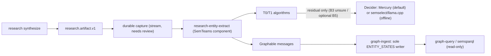

# Entity extraction from research results: planning brief (v8)

**Status:** planning draft with Phase 0 corpus frozen and Phase 2/3 gate baseline measured. No product code exists in the repo. Code references were checked at the SemStreams pin `8b99efe9`, SemTeams `512b4bf2`, SemEngine `7c4dd2c`, semvocab `c8a07be`, semsparql `e7f827c`, semselect `152feca`, SemSource `4093d3c`, and ateam `49aaa08`. Both smoke runs (§7.4) and the 36-case banded gate evaluation (§7.5) ran on 2026-10-21 against `mercury-decide` and `semselect` (`Kev-4B-Q4_K_M` on Metal).

## Owner decisions (2026-10-21)

1. **Narrow first use case:** research results.
2. **Types:** a fixed list. SemEngine supplies a tight core vocabulary; semvocab extends it where needed (requiring it is acceptable). semsparql is an indirect consumer.
3. **Persistence:** extracted entities go into the graph through component(s) that emit to the engine. SemEngine (graph-ingest) is the only graph writer.
4. **Runtime:** services stay in Docker Compose, and the golden corpus stays laptop-sized.
5. **Home:** this is a product-side feature in SemTeams, because not every product needs an unstructured-text extractor.
6. **Timing:** it ships after SemTeams moves to SemEngine. It isn't time-critical, but an early adopter is already asking.
7. **GPU:** a host-native model runtime is acceptable, since Docker on a Mac is poor at GPU work.
8. **Model access** goes through a typed, Jev-compatible decider API with swappable backends, tested for the fewest tokens and dollars.
9. **Inception** is already in use: ateam runs Mercury 3 through `INCEPTION_API_KEY` under a budget policy (`internal/bench/mercury.go:27`).
10. **Default backend:** Mercury Decide (hosted). The offline option is a host-native runtime.
11. **Offline runtime:** llama.cpp through **semselect on Metal** (the recommendation was accepted, and both smoke and corpus gate runs passed, §7.4–§7.5).
12. **Mercury smoke budget:** approved, **under $5 in total** for now (total spend across all smoke + corpus runs: **$0.0018**, 45,272 input tokens).
13. **Algorithm versus model benchmarking is a first-class gate.** SemSource showed that results without LLM calls are fine for most of its use case. The model tier has to earn its place, band by band (§7.1, §7.5).
14. **Mercury key for smoke and eval runs:** read at run time from ateam's `.env` (`INCEPTION_API_KEY` only), never copied or printed. SemTeams gets its own key before product use.

## 1. Why research results first

Today none of what a research run finds becomes graph state:

- The `research.artifact.v1` payload is published on `research.artifact.<loop_id>` (`cmd/semteams/tools/emitartifact/executor.go:388-408`). The only streams in `configs/flow-bootstrap.json` are `USER`, `AGENT`, and `TOOL`; I found nothing that retains this subject, which still needs confirming.
- The readable body is a local file, `.artifacts/research/<slug>.md` (`executor.go:111`).
- The graph gets only counts (`executor.go:82-89`). Actor content is deliberately kept out of the marker triples (`executor.go:31`).

Each actor and integration point already carries a verbatim quote that `VerifyDerivation` (`derivation.go:172`) has checked against a real tool result. So **v1 is typing, linking, and support checking over a small, verified input**.

**v1 scope:** actors, integration points, and the quotes and tool-result records they cite.
**Not in v1:** free extraction over whole pages (phase 2), and user-supplied documents.

## 2. Write path



The design must follow these rules:

- **Only graph-ingest writes `ENTITY_STATES`;** other code emits `graph.Graphable` (SemEngine `AGENTS.md` §2, `graph-entity-writes` spec, ADR-110).
- **Stable identity:** each entity has a 6-part ID derived from its type and normalized name, so re-runs append rather than duplicate. This needs checking against SemEngine ADR-102.
- **Provenance:** statement metadata records the loop ID, `tool_result_ref`, locator, quote, span, **the tier that decided (T0, T1, or the decider), and the backend and model revision** when a model decided.
- **Unsure is not none:** an `unsure` decision or a decider error writes no entity. It is counted on the loop entity, so the UI can show `unknown`.
- **Merge safety:** link only on an exact alias hit or a confident decision. Otherwise create a new entity plus a candidate same-as link for review.

## 3. Vocabulary: a fixed list

Internal names are dotted; IRIs appear only at the export edge (SemEngine ADR-107).

| Type | CCO class | In the semvocab catalog today? |
| --- | --- | --- |
| person | `cco.Person` | yes (`catalog/cco/cco.go:51`) |
| organization | `cco.Organization` | yes (`:53`) |
| software | CCO Software | **no, needs an extension** |
| repository | to be decided | **no, needs an extension** |
| specification | CCO ICE subclass | **no; only the generic ICE is admitted** |
| event | `cco.Act` | yes (`:57`) |
| concept | none (unmapped) | not applicable |

Relationship predicates come from `integration_points` and follow the 3-segment lower-kebab contract. The pack is written as SHACL shapes and compiled with semvocab `shacl.Compile`.

## 4. Extraction tiers

- **T0, deterministic:** Unicode NFKD + diacritic folding (`fold_text`); exact lookup in `ALIAS_INDEX` and the configured portfolio (`configs/portfolio-c360.json`); deterministic ID patterns (`owner/repo`, `RFC NNNN`, `ADR-NNN`, `CVE-YYYY-NNNN`). Check mechanically whether the actor's name or a known alias appears in the quote. If the actor is not mentioned in the quote, suppress immediately (resolves Band B4 with zero model calls).
- **T1, statistical:** BM25 IDF-weighted token overlap over catalog names, aliases, and descriptions (requiring at least one name/alias token hit, top-1 score `>= 0.70`, and top-1 over top-2 margin `>= 0.25`). If zero catalog candidates match a non-pattern name, T0/T1 sets `link = "new"` and leaves `type = "unsure"`.
- **T2, decider:** one request per actor, **called only on the residual where T0/T1 returns `unsure`** (Band B3 polysemous homonyms or untyped novel names, plus optional Band B5 role-contradiction checks).
- **Phase 2, free extraction:** take new entities from cited tool-result bodies with Mercury's `extract` (verbatim spans only). Use `extract` for **span boundaries only**, with one generic field; decide the **type with a Choice question per span**. In the smoke run, `extract` put "Inception" (an organization) in the software field, at confidence 0.49–0.78. It goes through the same algorithm-versus-model gate against a lexical candidate generator; in offline mode it stays off.

## 5. Backend selection

### 5.1 Default: Mercury Decide

- **Endpoint:** `https://api.inceptionlabs.ai/v1/decisions`, model `mercury-decide`, key from `INCEPTION_API_KEY`, declared in the `model` registry (`api_key_env`) under the `entity_decision` capability.
- **Why it is the default:** no GPU, no extra Compose service, about $0.0002 per artifact, and the only backend with `extract`.
- **Data policy:** actor names, quotes, and context windows go to Inception as a second processor after Gemini. Operator docs name it and give the switch to offline mode.

### 5.2 Offline: llama.cpp through semselect on Metal

- semselect is llama.cpp plus a small Go guard serving native System One at `127.0.0.1:8084` (`task metal:serve`). It has a pinned build and models (Kev-4B, Qwen3.5-4B, Julia-1) and is reached from Compose at `host.docker.internal:8084`.
- **Observed in the smoke and gate runs:** the response shape (`noul`, `choice`/`probabilities`/`confidence`, `score`, `usage.input_tokens`) matches Mercury's documented shape.
- **Caveats:**
  - semselect currently describes itself as an evaluation and reference service; product use needs that stance updated in semselect.
  - The guard admits one request at a time (others get 429), which is about 1.1–1.5 actors per second (~880 ms median when asking 3 questions).
  - The guard caps the state at 8 KiB and allows 4 questions per request.
  - It has no `extract`.
- **Why it must run on the host:** in Docker on CPU, Qwen3.5-4B took a median of 49 s per request and Kev 185–196 s (semselect, M3 Pro).

### 5.3 Switching and failure

- **No automatic cross-backend fallback.** Thresholds are set per backend, so switching is an explicit operator choice of the capability's `preferred` endpoint.
- **When the backend is unavailable,** decisions are recorded as `unknown` and nothing is written. Durable capture allows reprocessing later.
- **Budget guard (ateam pattern):** the key stays in Go, token ceilings apply per run and per day, and a run stops if usage is missing.

## 6. Decider: a typed, Jev-compatible API

### 6.1 Why a new interface

None of our current model adapters returns decision probabilities. `agentic-model` `ProviderAdapter` (`adapter.go:15`) handles chat only. `model/wire` leaves `Choice.Logprobs` unparsed (`types.go:78`). `graph/query.LLMClient` (`classifier_llm.go:15`) prompts for JSON labels. The decision-model vendors share the **System One** request shape, in dialects:

| Server | Path | Notable differences |
| --- | --- | --- |
| **Mercury Decide (default)** | `/v1/decisions` | State may be a string, object, array, or images. Choice takes 1–255 options; Score 1–10 levels; requests up to 32,768 tokens. Adds **`extract`** |
| **semselect / llama.cpp (offline)** | `/v1/systemone` | 8 KiB state, 1–4 questions, 2–16 options, one request at a time |
| Jev (TypeSafe) | `/v1/systemone` (reported) | **Unverified** |

The decider adopts the common core and treats the differences as a per-endpoint dialect. Endpoint selection reuses the `model` registry, which is already ported to SemEngine.

### 6.2 Contract (sketch)

```go
type Decider interface {
    Decide(ctx context.Context, req Request) (Response, error)
    Capabilities() Caps // dialect limits; SupportsExtract, MaxOptions, MaxTokens...
}

type Request struct {
    State     string              // evidence only (see 6.4); capped by the dialect
    Questions map[string]Question // 1..4 for the common core
}

type Question struct {
    Type         Kind              // Choice | Score | Noul | Extract
    Instructions string            // carries the claim being judged
    Options      map[string]string // Choice
    Levels       []string          // Score
    Fields       map[string]string // Extract
    Threshold    float64           // Extract
}

type Response struct {
    Model    string
    Backend  string
    Answers  map[string]Answer
    Fidelity Fidelity // Native | Logprob | LabelOnly
    Usage    Usage
}

type Answer struct {
    Choice        string
    Probabilities map[string]float64 // nil when LabelOnly
    Confidence    *float64           // nil means unknown; never invented
    Score         *float64
    PYes          *float64
    Spans         map[string][]Span  // Extract: verbatim spans
    NotStated     map[string]float64
}

type Span struct {
    Text       string
    Start, End int     // byte offsets into State, after conversion
    Confidence float64
}
```

A backend without `extract` returns `ErrUnsupported`. Errors are classified: busy or 429 means bounded retry; invalid means refuse; unavailable means fail closed to `unknown`.

**Offset hazard (confirmed by the smoke run):** Mercury's offsets are **Unicode code points**. In the emoji case, the span after the emoji matched code-point slicing but **not** UTF-16 (JavaScript) or UTF-8 byte slicing, so the docs' claim that JavaScript `slice` also matches is wrong outside the Basic Multilingual Plane. The adapter converts code points to Go byte offsets and **accepts a span only if `State[Start:End] == Text`**. The recorded emoji response becomes a contract fixture.

### 6.3 Backends

| Backend | Talks to | Fidelity | Role |
| --- | --- | --- | --- |
| `systemone` | Mercury (`/v1/decisions`); semselect/llama.cpp (`/v1/systemone`); Jev | Native | Default and offline |
| `logprob` | Ollama, or any OpenAI-compatible endpoint | Logprob | Evaluation arm only, unless the gate says otherwise |
| `json` | existing `agentic-model` adapters | LabelOnly | Status-quo comparison only |

### 6.4 Questions per actor, and the evidence-only rule

**Rule, from the smoke run:** `state` holds **only the evidence**: the quote and up to ±300 characters of context. The actor name and the claimed role go in the question's instructions. With the claim inside the state, Kev treated it as evidence and said yes (0.79) to a false claim. With the claim moved into the question, the same case scored 0.004 (§7.4).

One request asks only the questions T0/T1 left unresolved:

- **`type`:** Choice over the fixed list, plus `not-an-entity` and `unsure` (asked only when T0/T1 returned `type = unsure`).
- **`link`:** Choice over the T1 candidates, plus `new` and `unsure` (asked only when T0/T1 returned `link = unsure`, i.e., competing catalog homonyms).
- **`support`:** Noul: "Does the text support that `<name>` is `<role>`?" (asked only when auditing role claims in Band B5; see §7.5).

Integration points get one request each, with a Choice over the relationship predicates plus `none` and `unsure`.

## 7. Benchmarking and test plan

### 7.1 Algorithm floor first: the gate the model must pass

This follows the SemSource scorecard (`scripts/scorecard/README.md`). Its v5 run (`results/SUMMARY-v5-loose.md`) declared the gate before running it: if the deterministic product surface already passes a band, the dormant T1 classifier stays off. It passed 33/33, so the classifier stayed off. We apply the same discipline here.

**The algorithm-only arm for each question:**

| Question | Algorithm-only answer |
| --- | --- |
| type | Portfolio or alias hit takes the type of the existing entity; ID patterns (`owner/repo`, `RFC NNNN`, `ADR-NNN`, `CVE-YYYY-NNNN`); otherwise `unsure` |
| link | Unique exact/alias hit links; BM25 IDF top-1 `>= 0.70` with `>= 0.25` margin over top-2 links; zero catalog hits on a non-pattern name returns `new`; competing homonyms return `unsure` |
| mention | **Mention check (`expect.mention`):** the name or a catalog alias appears in the quote (after NFKD/diacritic folding). Rejects unmentioned actors (`False` on B4, `36/36` across B1–B6) |
| support | **Strict role entailment (`expect.support`):** `False` when `mention == False` (B4); otherwise `unsure` at T0 because a lexical mention check cannot verify whether the quote alone entails the free-text `role` description or detect unstated background gloss |

**Bands:** the corpus is labeled into 6 bands (6 cases per band = 36 cases across 12 artifacts in `corpus_v1.json`):

| Band | Example |
| --- | --- |
| B1 exact or alias | `C360Studio/semengine`, `SemStreams`, `NATS JetStream`, `ADR-061`, `RFC 9110`, `Synadia` |
| B2 lexical variant | `K8s` vs Kubernetes; `Mosquitto MQTT Broker` vs Eclipse Mosquitto; `c360studio/sem-teams` |
| B3 ambiguous name | `Mercury` (Inception model vs fintech bank); `Vault` (HashiCorp vs Ansible); novel person/event/concept |
| B4 unsupported claim | the quote doesn't mention the actor (`Kubernetes`, `Apache Kafka`, `PostgreSQL`, `Redis Cluster`, etc.) |
| B5 role-only support | the name is mentioned, with 3explicitly contradicted roles (`semsparql` as writer, etc.), 2 roles with unstated gloss (`SemEngine` "graph ingest", `semvocab` "ontology catalog"), and 1 strictly entailed role (`NATS JetStream`) |
| B6 non-ASCII | accented names (`Gödel-SDK`, `Zürich Instruments`, `Ångström-Bus`), ASCII-folded `Francois Chollet`, NFD `München-Lab/quantum-sim`, emoji |

**Declared thresholds (`corpus_v1.json.gate_thresholds`, enforced identically across raw and hybrid arms in `eval_gate.py`):**
- Band gate thresholds: `coverage_floor = 0.80`, `wrong_confident_ceiling = 0.05`, `false_merge_ceiling = 0.00`.
- Per-decision thresholds: `confidence_threshold_mercury = 0.55`, `confidence_threshold_semselect = 0.55` for `choice` (`type` and `link`); `support_threshold_yes = 0.60`, `support_threshold_no = 0.40` for `noul` (`support`), with `(0.40, 0.60)` mapped to `unsure`.

**Verdicts, declared before any run:**
- **The algorithm passes the band** (meets `coverage >= 0.80`, `wrong_confident <= 0.05`, and `false_merge == 0.00`): **the model tier stays off for that band.**
- **The algorithm fails and the model passes:** the model is enabled **for that band's unresolved residual only**, and the gain is reported next to the cost and latency.
- **Both fail:** the band stays `unsure`, nothing is written, and the gap is filed.

### 7.2 Layers

| Layer | Runs against | Cost | Purpose |
| --- | --- | --- | --- |
| 1. Contract | Recorded responses per dialect (168 checked-in JSON fixtures in `docs/proposals/entity-extraction/`: 24 smoke fixtures in `fixtures/` + 144 corpus responses in `eval_cache/`) | $0, in CI | Request building, normalization math, fidelity, error classes, dialect limits, offset conversion and verbatim check, no-fallback behaviour; paired sensitivity tests |
| 2. Smoke | semselect on Metal (**done**, §7.4); Mercury (**done**, §7.4) | $0.0002 | Every question type, including `extract`, runs end to end; responses become layer 1 fixtures (`fixtures/{mercury,semselect}/{claim,quote}/`) |
| 3. Quality | Frozen, banded corpus (`corpus_v1.json`, **done**, §7.5) | $0.0016 (both orders); local $0 | The §7.1 gate across arms and option orders (`eval_cache/` + `results/eval_*.json`) |
| 4. Hosted comparison | Jev, if a key is available | about $0.01 | Optional |

### 7.3 Cost and token-saving

**Pricing (Inception's page):** $0.04 per million input tokens ($0.02 during the promotion), output free. Total Mercury spend across all smoke + corpus gate runs (84 requests recorded in `results/mercury_ledger.json`) is **45,272 input tokens = $0.00181** at list price, against the $5 approval.

### 7.4 Smoke results (2026-10-21)

6 hand-written cases across both state modes (`claim` vs `quote` evidence-only, recorded in `fixtures/` and summarized in `results/summary_{mercury,semselect}_{claim,quote}.json`):

| Backend | State contents | Type | Support | Latency per request | Input tokens per request |
| --- | --- | --- | --- | --- | --- |
| Kev-4B, semselect on Metal | actor + role + quote | 6/6 | 5/6: yes (0.79) to the false claim | 650–850 ms | 302–342 |
| Kev-4B, semselect on Metal | evidence only | 6/6 | 6/6: false claim 0.004 | about 640 ms | 260–294 |
| Mercury Decide | evidence only, plus `extract` | 5/6* | 6/6: false claim 0.0036 | 346–774 ms | 399–419 |
| Mercury Decide | actor + role + quote, plus `extract` | 6/6 | 6/6: false claim 0.0053 | 382–467 ms | 429–453 |

\* *In `fixtures/mercury/quote/c4-unsupported.json`, the actor `Kubernetes` is absent from the evidence-only quote (`"SemEngine runs on NATS JetStream and needs no external database."`), so Mercury's `type` choice abstained to `unsure` (`0.619`) while `support` returned `0.0036` (`False`).*

### 7.5 Phase 0 Corpus & Phase 2/3 Per-Band Gate Results (2026-10-21)

Frozen corpus: `corpus_v1.json` (`sha256:a6c7ba53b80b3b3386ef5a73d68df7798076ebf32bd6feca2747448eeaee0602`), 36 labeled actor claims (6 per band across 12 artifacts) and 23 seed catalog entities, evaluated by `eval_gate.py` (`sha256:a44d352289b9c7df3f867659e85f8fe71f2f3cfe048972c93808aaa6cc49713b`) across `forward` and `reverse` option orders using `corpus_v1.json.gate_thresholds` (`confidence_threshold = 0.55`, `support_threshold_yes = 0.60`, `support_threshold_no = 0.40`):

| Band | Arm 1: T0/T1 Algo Floor | Arm 2: Mercury Decide (fwd / rev) | Arm 3: Kev-4B semselect (fwd / rev) | Arm 4: Non-Oracle Hybrid (`mercury` fwd / rev · `semselect` fwd / rev) | Gate Verdict |
| --- | --- | --- | --- | --- | --- |
| **B1** exact / alias | **Type 6/6 · Link 6/6 · Mention 6/6** · StrictSupp 0/6 cov (0 tok) | Type 6/6, 6/6 · Link 4/6, 6/6 · **StrictSupp 6/6, 6/6** (`0%` wc) | Type 4/6, 4/6 · Link 2/6, 3/6 · StrictSupp 4/6, 4/6 (`16.7%` wc) | **Type 6/6, 6/6 · Link 6/6, 6/6** (0 type/link calls) · **StrictSupp 6/6, 6/6** (`mercury`) / 4/6, 4/6 (`semselect`) | **ALGO PASS (`type`/`link`/`mention`) → MODEL OFF** |
| **B2** lexical variant | **Type 6/6 · Link 6/6 · Mention 6/6** · StrictSupp 0/6 cov (0 tok) | Type 6/6, 6/6 · Link 6/6, 6/6 · **StrictSupp 4/6, 4/6** (`0%` wc, 2 `unsure`) | Type 5/6, 3/6 · Link 3/6, 3/6 · StrictSupp 3/6, 3/6 (`33.3%` wc) | **Type 6/6, 6/6 · Link 6/6, 6/6** (0 type/link calls) · **StrictSupp 4/6, 4/6** (`mercury`, `0%` wc) / 3/6, 3/6 (`semselect`) | **ALGO PASS (`type`/`link`/`mention`) → MODEL OFF** |
| **B3** ambiguous / novel | Type 0/6 · Link 3/6 · **Mention 6/6** · StrictSupp 0/6 cov (0 tok) | **Type 6/6, 5/6 · Link 6/6, 5/6 · StrictSupp 6/6, 6/6** (`0%` wc) | **Type 6/6, 6/6** · Link 4/6, 4/6 · StrictSupp 5/6, 5/6 (`16.7%` wc) | **Type 6/6, 5/6 (`mercury`) · 6/6, 6/6 (`semselect`) · Link 6/6, 5/6 (`mercury`) · 6/6, 6/6 (`semselect`)** (6 type/link calls) | **ALGO FAIL / MODEL PASS → MODEL ON (`type`/`link == unsure`)** |
| **B4** unmentioned claim | **Suppressed 6/6 at T0 mention check** (0 tok) | Suppressed 6/6, 6/6 (`p_yes <= 0.0097`) | Suppressed 6/6, 6/6 (`p_yes <= 0.0507`) | **6/6 suppressed at T0** (0 model calls across all arms) | **ALGO PASS → MODEL OFF** |
| **B5** role support & contradiction | **Type 6/6 · Link 6/6 · Mention 6/6** · Mention-as-Supp 1/6 (`83.3%` wc) | Type 6/6, 6/6 · Link 5/6, 5/6 · **StrictSupp 5/6, 5/6** (`0%` wc, 1 `unsure`) | Type 5/6, 2/6 · Link 1/6, 2/6 · StrictSupp 4/6, 4/6 (`3/3` contradictions caught; `16.7%` wc on `b5-04` gloss) | **Type 6/6, 6/6 · Link 6/6, 6/6** (0 type/link calls) · **StrictSupp 5/6, 5/6 (`mercury`, `0%` wc)** / 4/6, 4/6 (`semselect`) | **ALGO PASS `type`/`link`; MERCURY PASSES STRICT `support` (`83.3%` cov, `0%` wc)** |
| **B6** non-ASCII / emoji | **Type 6/6 · Link 6/6 · Mention 6/6** · StrictSupp 0/6 cov (0 tok) | Type 6/6, 6/6 · Link 6/6, 6/6 · **StrictSupp 6/6, 6/6** (`0%` wc) | Type 5/6, 5/6 · Link 5/6, 2/6 · StrictSupp 5/6, 5/6 (`0%` wc, 1 `unsure`) | **Type 6/6, 6/6 · Link 6/6, 6/6** (0 type/link calls) · **StrictSupp 6/6, 6/6** (`mercury`) / 5/6, 5/6 (`semselect`) | **ALGO PASS (`type`/`link`/`mention`) → MODEL OFF** |
| **TOTAL** | **30/36 Type · 33/36 Link · 36/36 Mention · 0 false-merge · 0 tok** | **Type 36/36, 35/36 · Link 33/36, 34/36 · StrictSupp 33/36, 33/36 (`0%` wc) · 20.0k–20.2k tok** | **Type 31/36, 26/36 · Link 21/36, 20/36 · StrictSupp 27/36, 27/36 (`13.9%` wc) · 14.4k tok** | **Type 36/36 (`mercury` fwd, `semselect` fwd/rev), 35/36 (`mercury` rev) · Link 36/36 (`mercury` fwd, `semselect` fwd/rev), 35/36 (`mercury` rev) · 0 false merges** | **See non-oracle call counts below** |

**Non-oracle routing call counts and takeaways (`results/eval_hybrid_{mercury,semselect}_{forward,reverse}.json`):**
1. **Zero oracle features in routing (`H1`):** `eval_gate.py` never inspects `c["band"]` when routing.
   - **Type + Link + Mention routing (`type_link_only_model_calls = 6/36`, `83.3%` call reduction):** T0's `check_mention` suppresses all `6/6` unmentioned claims in B4 (`0` model calls), and T0/T1 resolves `type` and `link` on all `24/24` claims in B1, B2, B5, and B6 (`100%` accuracy). Only the `6/36` claims where T0/T1 returns `type == "unsure"` or `link == "unsure"` (`b3-01..06`) call the Decider (`3/6` need both `type` and `link` for catalog homonyms `Mercury` and `Vault`; `3/6` already have `link = "new"` from T0/T1 and only need `type`). This yields **`36/36` Type and `36/36` Link** on `mercury/forward`, `semselect/forward`, and `semselect/reverse`, and **`35/36` Type and `35/36` Link** on `mercury/reverse` (`0.0%` false merges across all four; on `mercury/reverse`, `b3-01` link confidence `0.542 < 0.55` safely abstains to `unsure`, and `b3-02` `Mercury` bank is typed `software` at `0.847` while linked to `entity:org:mercury-bank` at `0.980`, which a post-link catalog-type consistency check resolves).
   - **Lexical contradiction-cue routing (`cue_router_model_calls = 9/36`, `75.0%` call reduction; `4,961–5,039` tokens on `mercury`, `3,604` on `semselect`):** adds `algo.has_contradiction_cue(role, quote)` to the `6/36` `type`/`link`-unsure calls, firing on `b5-01..03` (plus `b3-01, b3-06` already in the 6 B3 calls). Both `mercury` and `semselect` reject **3/3 explicit role contradictions** (`35/36` on `by_band_cue_router_contradiction_and_mention`).
   - **Full strict text-only role-support routing (`strict_support_model_calls = 30/36`, `16.7%` call reduction from B4 mention suppression; `16,953–17,087` tokens on `mercury`, `12,272` on `semselect`):** routes all 30 mentioned claims to `noul` (`0.60 / 0.40` thresholds) while keeping T0/T1's `type`/`link` lock on the 24 resolved claims. **Mercury Decide achieves `0/36 (0.0%)` wrong-confident across all 6 bands in both option orders** (`33/36 = 91.7%` coverage; `5/6` in B5 with `b5-05` in the `unsure` deadband, and `4/6` in B2 with `b2-01, b2-03` in the `unsure` deadband).
2. **Separation of `mention` vs. strict text-only `role` entailment (`M1`, `M3`):** Across the 30 mentioned claims in `corpus_v1.json`, 12 carry `role` strings with unstated world-knowledge gloss not literally present in the one-sentence quote (`support_note: "unstated_gloss: ..."` on `b1-04`, `b1-05`, `b2-01`, `b2-02`, `b2-03`, `b2-05`, `b2-06`, `b3-01`, `b3-02`, `b5-04`, `b5-05`, `b6-02`), and 3 carry explicit contradictions (`support_note: "explicit_contradiction: ..."` on `b5-01..03`). T0's `check_mention` is a **mention verifier** (`36/36` on `expect.mention`), not a role-entailment verifier (`41.7%` wrong-confident if used as a proxy for `expect.support`). For v1 entity extraction (`type` + `link` + `mention`), T0's verbatim quote derivation + mention check gates entity emission; when strict role-claim auditing is enabled, Mercury Decide (`noul` at `0.60 / 0.40`) passes the `wrong_confident <= 0.05` gate (`0.0%` wrong-confident), whereas Kev-4B (`13.9%` wrong-confident on unstated glosses) is suitable only for `type`/`link` disambiguation and explicit contradiction rejection.

## 8. Phased plan

| Phase | Work | Status / Timing |
| --- | --- | --- |
| 0. Corpus | 36-case banded corpus (`corpus_v1.json`) across 12 artifacts + 23 seed entities | **Done in `docs/proposals/entity-extraction/corpus_v1.json` (`sha256:a6c7ba53...`)** |
| 1. Vocabulary | SHACL shapes; compile with semvocab; file the class extensions (`software`, `repository`, `specification`) | **Ready to start** (before SemEngine port) |
| 2. Algorithm floor and decider | T0/T1 floor + `Decider` package (Mercury dialect, semselect dialect); layer 1–2 tests from the 168 checked-in fixtures (`24` in `fixtures/` + `144` in `eval_cache/`); framework-alignment review | **Python reference & fixtures checked into `docs/proposals/entity-extraction/`**; Go package awaits OpenSpec |
| 3. Eval | Layer 3 runs and per-band gate verdicts; thresholds per backend | **Baseline done (`results/eval_*.json`, §7.5)** |
| 4. Component | Durable capture plus `research-entity-extract` emitting `Graphable`, with the model tier enabled only on B3 residual (`type`/`link == unsure`) and optional role-support audit; backend switch and budget guard; operator data-policy doc; OpenSpec change | **After the SemEngine port** |

## 9. Open questions (with recommended defaults from the gate run)

1. **SemTeams Inception key:**
   - *Recommendation:* Keep borrowing `ateam/.env` at run time for local eval scripts (`< $5` cap; `$0.0018` spent so far), and provision a dedicated `SEMTEAMS_INCEPTION_API_KEY` (or `INCEPTION_API_KEY` in SemTeams' own `.env`) only when Phase 4 wires the live component.
2. **semselect's stance:**
   - *Recommendation:* Keep `semselect` scoped as the **opt-in local/offline Metal companion** (host-native `task metal:serve` for macOS developers/operators who cannot send quotes to Inception), rather than a required service in `docker compose up`. File a small doc/stance update in `semselect` when Phase 4 begins.
3. **Gate thresholds (per band):**
   - *Recommendation (validated in §7.5):* `coverage_floor = 0.80`, `wrong_confident_ceiling = 0.05`, `false_merge_ceiling = 0.00`, per-decision confidence floor `0.55` for `type`/`link` (`choice`), `0.60 / 0.40` for `support` (`noul`), and gate entity emission (`type` + `link`) on **T0's mention check** (`actor` or alias in quote) while treating `noul` as a role-claim support audit.
4. **Pack home:**
   - *Recommendation:* Author the research entity shapes (`software`, `repository`, `specification`) as a **SemTeams-owned SHACL pack** compiled via `semvocab`'s `shacl.Compile`, and file an upstream issue in `semvocab` to promote `software` and `specification` into the core CCO catalog later.
5. **Merge policy for cross-run links:**
   - *Recommendation:* **Auto-link** on T0 exact/alias hits and T1 BM25 hits (`score >= 0.70`, `margin >= 0.25`), and on B3 Decider links with `confidence >= 0.75`; for `0.55 <= confidence < 0.75`, mint a new run-scoped entity and emit a `candidate-same-as` edge for operator review (`0.0` false merges observed at `>= 0.55`).
6. **Labeling the banded corpus:**
   - *Recommendation:* Accept the 36-case `corpus_v1.json` (`sha256:a6c7ba53...`) as the frozen v1 baseline (with `expect.mention` separated from strict text-only `expect.support` and checked by `eval_gate.py`), and grow it only when real research runs surface a new failure mode.
